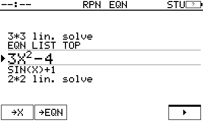
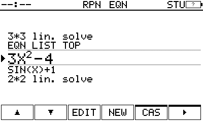
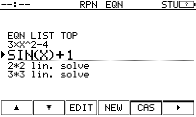
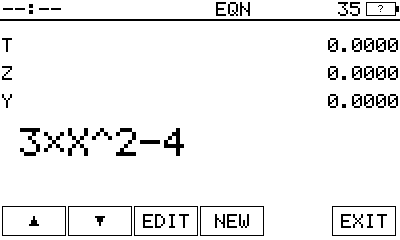
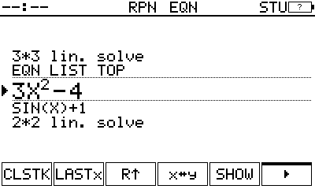
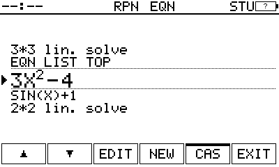
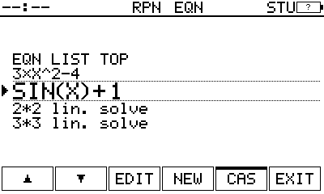
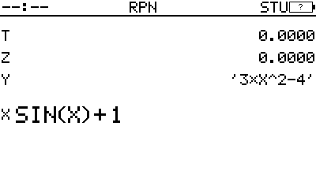

# s3-keys: where →X and →EQN go, two prototypes (unit 082, abacus #11334)

Michael's note: "Drop exit for a more button and put the new keys there or in a stack sub menu? The C button can exit
out." Both are built below as throwaway prototypes on 9a08b6e (the diffs are prototype-a.patch and prototype-b.patch;
neither is on main). Every frame is the firmware's own screen render, through the app's key path. The state: STU, two
equations, 3×X^2-4 and SIN(X)+1, with the list open on the first. "Drop two" means both onto the stack, X then Y.

In both prototypes CAS4 is gone and CAS3's ▸ goes back to CAS, as before 082. A menu's key is one-shot, as every menu
today: after →X the list's bar comes back.

## Today (82 as built): CAS, ▸ ▸ ▸, →X

|  |  |
|---|---|
| 1. The list, EXIT on F6 | 2. CAS ▸ ▸ ▸: CAS4 |

Drop two: CAS ▸ ▸ ▸ →X, ▼, CAS ▸ ▸ ▸ →X: **11 keys**.

## (a) EQN LIST's EXIT becomes ▸ (STU), its page →X →EQN

|  |  |
|---|---|
| 1. The list: ▸ on F6 where EXIT was | 2. ▸: the page, →X, →EQN, ▸ back to the list |
|  |  |
| 3. →X: X is 3×X^2-4, the list's bar back | 4. ▼: the second equation |
|  |  |
| 5. ▸ →X: X SIN(X)+1, Y 3×X^2-4 | 6. C: out of Equation mode, the stack |
|  |  |
| 35s: EXIT kept (→X refuses a 35-stamped entry) | 33s: EXIT kept |

Drop two: ▸ →X, ▼, ▸ →X: **5 keys**. Then C leaves.
- Outside STU, F6 stays EXIT. →X there would only ever say INVALID DATA, so a ▸ would lead to keys that refuse.
- Not prototyped, a variant: the page could carry ▲ ▼ and stay open after →X (as CPLX stays). Drop two would be
  ▸ →X ▼ →X, **4 keys**.

## (b) a stack submenu: STACK's sixth key ▸, its page →X →EQN

|  |  |
|---|---|
| 1. The list, unchanged: EXIT on F6 | 2. BLUE R↓: STACK, ▸ on its free F6 |
|  |  |
| 3. ▸: the page, →X, →EQN, ▸ back to STACK | 4. →X: X is 3×X^2-4, the list's bar back |
|  |  |
| 5. ▼, BLUE R↓ ▸ →X: X SIN(X)+1, Y 3×X^2-4 | 6. C: the stack |

Drop two: BLUE R↓ ▸ →X, ▼, BLUE R↓ ▸ →X: **9 keys**.
- From the list, STACK's own four keys (CLSTK, LASTx, R↑, x↔y) are ones Equation mode refuses (NOT IN EQN, unit 073).
- From the stack, with the list closed, both keys only give the brief notice NO EQN today (calc.c sends AB_EQDROP and
  AB_EQSTORE to Equation mode's list only). For (b) to read as a stack menu, the core would need →EQN to store X's
  expression with the list closed, and →X to drop the current equation. My estimate, not built: about 10 lines in
  calc.c, plus tests.

## Both

- **While the list is open the stack isn't on the screen** (frames 3 to 5 of each), so neither drop shows until C.
- **INVALID DATA on →EQN with a number in X** goes in with whichever Michael picks (abacus #11224).

## Does C leave EQN LIST everywhere EXIT does? (measured at 9a08b6e, through the app's keys)

| where | EXIT (F6) | C |
|---|---|---|
| the list's bar, STU | leaves Equation mode | leaves Equation mode: the same |
| the list's bar, 35s | leaves | leaves: the same |
| the list's bar, 33s | leaves | leaves: the same |
| EQN LIST TOP (after NEW), each model | leaves | leaves: the same |
| after →X twice, the list's bar | leaves | leaves: the same |
| a CAS page (CAS, CAS2, CAS3, CAS4) | no EXIT there (F6 is ▸) | back to the list's bar; a second C leaves |
| GOLD armed (the REG bank) | F6 is ( ): starts a typed equation | disarms GOLD; a second C leaves |
| a message showing (INVALID DATA) | not measured | clears the message; a second C leaves |
| the editor (EDIT) | no EXIT there | leaves Equation mode at once, not back to the list |

So yes: wherever EXIT is on the bar, C does what EXIT does, in STU, 35s and 33s. Elsewhere C takes one step back (a CAS
page, an armed shift, a message) before it leaves. One exception: from the editor, C leaves Equation mode at once.
